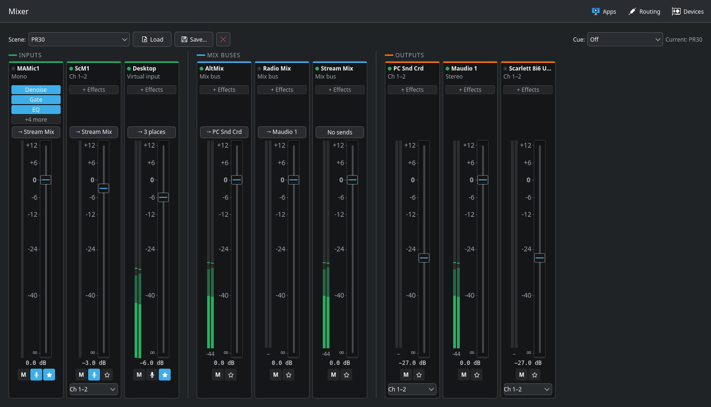

# Patch Prime

A virtual audio mixer and router for KDE Plasma, built on PipeWire. Think of it as a small mixing console for your desktop: every input, app and output gets a channel strip, you decide what goes where, and you can process any strip with built-in effects. Inspired by Ginger Audio's CASTER on macOS.



## What it does

- **A console for your sound.** Each device you choose gets a channel strip with a fader, mute, meters and a label you pick. Strips are grouped into inputs, mix buses and outputs.
- **Route anything anywhere.** Send any input to any mix bus or output, each send at its own level. The Routing page shows every send as a grid.
- **Mix buses and virtual devices.** Make a "Stream Mix" for OBS, a "Chat Mic" for Discord, or a "Desktop" input that carries all your system sound.
- **Per-app routing.** Choose where each application plays or records. The choice is remembered and applied when the app starts.
- **Built-in effects**, as insert slots on each strip:
  - 6-band parametric EQ, with a curve you drag;
  - 4-band multiband compressor;
  - noise gate and AI noise suppression (RNNoise);
  - ducker (music dips while you talk);
  - broadcast leveler and safety limiter;
  - reverb;
  - delay, to line up outputs with different latency.
- **Scenes.** Save the whole mix, including effects, under a name and load it back.
- **Cue.** Listen to any strip alone in your headphones without changing the mix.
- **Metering.** Peak, RMS and peak hold on every strip, short-term loudness (LUFS) on mix buses and outputs, and gain-reduction meters in the effects.
- **Pro-audio friendly.** Choose the sample rate and block size, use one hardware interface as the master clock or let Patch Prime keep time, pick stereo pairs on multichannel cards, and have hot-plugged devices recovered automatically.
- **Runs in the background.** The engine (`patchprimed`) is a systemd user service. Your routing keeps working with the window closed and comes back after a reboot.

See the **[user guide](docs/HELP.md)** for how to use it.

## Status

Under active development and in daily use on the author's machine. Phases 1–6 (devices, mixer, routing, apps, scenes, effects, monitoring) are done. Next: packaging, then plugin hosting (LV2 first) and hardware control.

## Requirements

- Ubuntu 26.04 (or similar) with KDE Plasma 6
- PipeWire 1.6 and WirePlumber 0.5
- Qt 6.10, Kirigami (KF6)

## Building

Build dependencies on Ubuntu 26.04:

```sh
sudo apt install cmake ninja-build g++ qt6-base-dev qt6-declarative-dev \
    libpipewire-0.3-dev libspa-0.2-dev libkirigami-dev kirigami-addons-dev
```

```sh
cmake --preset gcc-debug          # or clang-debug
cmake --build --preset gcc-debug
ctest --preset gcc-debug
```

The noise suppression uses [RNNoise](https://github.com/xiph/rnnoise) (BSD-3-Clause), which CMake downloads at configure time, checks against a fixed checksum, and builds in. To build without network access, configure with `-DPATCHPRIME_RNNOISE=OFF`; you then don't get noise suppression.

## Installing

```sh
cmake --preset gcc-release -DCMAKE_INSTALL_PREFIX=$HOME/.local
cmake --build --preset gcc-release
cmake --install build/gcc-release
systemctl --user daemon-reload
systemctl --user enable --now patchprimed
```

Set the prefix when configuring, not with `cmake --install --prefix`: the systemd unit, the D-Bus activation file and the `.desktop` launcher are written with the full path to the programs. The engine then starts at login, and **Patch Prime** is in the application menu. After rebuilding, `cmake --install build/gcc-release && systemctl --user restart patchprimed` updates it.

To take everything Patch Prime made out of PipeWire again: `patchprimed --remove-buses`.

## How it works

- `patchprimed`, the engine, owns everything that touches PipeWire. Each enabled device gets a *bus* (a PipeWire null sink) carrying its fader and mute, linked to the hardware. A strip with effects also gets a processing node running them on PipeWire's realtime thread. Strips without effects need no processing at all.
- `patchprime`, the window, is a D-Bus client of the engine (`org.kingsqueak.PatchPrime`) and contains no audio code.
- Settings live in `~/.config/patchprime/`: `devices.json` (devices, labels, levels, sends, effects), `apps.json` (app routes) and `scenes/`. Devices are recognised by name, not by PipeWire's numbers, so settings follow a device to another USB port.
- Patch Prime writes `~/.config/wireplumber/wireplumber.conf.d/60-patchprime.conf` for clock and scheduling rules, and restarts WirePlumber when that file changes.

## patchprime-probe

A small tool that connects to PipeWire once and prints the graph: nodes, devices, ports, links and the default devices.

```sh
build/gcc-debug/probe/patchprime-probe            # JSON
build/gcc-debug/probe/patchprime-probe --summary  # short device list
```

## License

Copyright © 2026 KC2RGW Chris

Patch Prime is free software: you can redistribute it and/or modify it under the terms of the GNU General Public License as published by the Free Software Foundation, either version 3 of the License, or (at your option) any later version. See [LICENSE](LICENSE).

RNNoise is Copyright Xiph.Org Foundation and others, under the BSD-3-Clause license.
